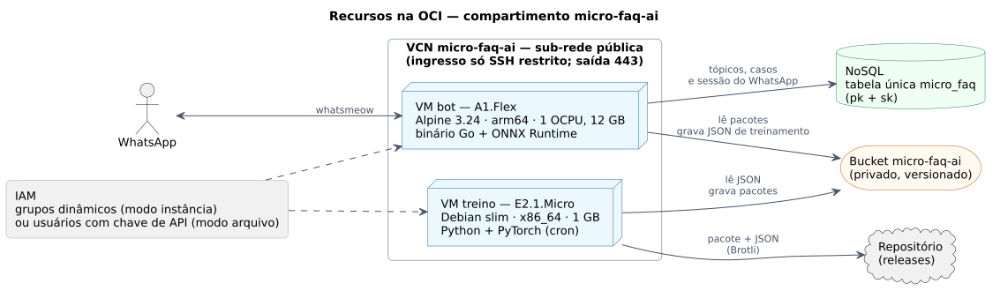

# micro-faq-ai

**Um FAQ que aprende sozinho dentro dos grupos de WhatsApp — classificador de tópicos em PyTorch servido por um binário Go de poucos megabytes.**

O bot lê as perguntas feitas nos grupos, identifica a qual tópico cada uma pertence e responde com a resposta cadastrada. Quando não tem certeza, pergunta ao próprio autor se a dúvida é uma de algumas alternativas; quando não sabe, repassa a dúvida a um grupo de administradores. Cada resposta dada por uma pessoa vira exemplo de treino, e o modelo é retreinado em lotes com o que foi acumulado — o FAQ cresce com o uso, sem ninguém escrever um dataset.

-----

## ✨ Destaques

* **Confiança decide o tom da resposta.** Acima de 80 % o bot responde direto; entre 50 % e 80 % mostra até três alternativas, cada uma com uma pergunta de exemplo, e deixa o autor escolher; abaixo de 50 % abre um caso para os administradores. Errar com confiança custa mais caro que perguntar, então só a faixa alta responde sozinha.
* **Sigmoide, não softmax.** Cada tópico tem probabilidade independente. Uma mensagem que não pertence a nenhum tópico recebe valores baixos em todos, em vez de ser empurrada para o menos distante — é isso que permite ao bot ler *todas* as mensagens de um grupo sem responder conversa comum.
* **Cumprimento, negação e conversa são tópicos treinados.** `_cumprimento`, `_negacao` e `_conversa` aprendem com exemplos como qualquer outro tópico, mas disparam comportamentos próprios: um "bom dia" recebe um cumprimento genérico, um "não era isso" reabre a dúvida, um "kkkk" fica sem resposta.
* **Inferência de 56 µs.** O modelo exportado em ONNX roda no ONNX Runtime oficial via CGO, medido contra a alternativa em Go puro: 56 µs contra 643 µs de média, 0,2 ms contra 58 ms no pior caso. O runtime fica atrás de uma interface, e o grafo respeita o que os dois executam — trocar de runtime é mudar um *build tag*, sem treinar de novo.
* **Mini-dicionário podado.** Dos 2 milhões de vetores do fastText `cc.pt.300`, o treino guarda só as palavras que aparecem nos exemplos — alguns megabytes, que viajam dentro do pacote do modelo. Palavras com erro de digitação ainda ganham vetor pelos n-gramas de caracteres.
* **Normalização em uma passada.** Unicode, letras repetidas, espaços, gírias (Aho-Corasick) e divisão em frases acontecem caractere a caractere, numa janela do tamanho da maior gíria, sem expressões regulares. Go e Python implementam a mesma especificação e passam pelos mesmos casos de teste — um caractere de diferença tiraria uma palavra do dicionário sem erro visível.
* **Treino barato, em lotes.** O retreino roda numa VM de 1 GB, uma vez por mês, e só se chegaram exemplos novos. O dicionário estático de 2,5 GB é lido por *memory map*, sem precisar caber em RAM.

-----

## 🏗️ Arquitetura

Duas VMs na Oracle Cloud que só se falam pelo bucket:

* **Bot** (Alpine, arm64): binário Go ligado ao WhatsApp via `whatsmeow`. Normaliza, classifica, conversa, grava exemplos confirmados no JSON de treinamento e troca o modelo em execução sem reiniciar, depois de testá-lo contra o exemplo canônico de cada tópico.
* **Treino** (Debian slim, x86_64): Python + PyTorch disparado pelo cron. Poda o dicionário, treina, exporta ONNX e publica um pacote Protocol Buffers autossuficiente — modelo, mini-dicionário, mapa de tópicos, gírias e versão.
* **Estado fora das VMs.** Tópicos, casos e a própria sessão do WhatsApp ficam numa tabela única do Oracle NoSQL (`pk` + `sk`); exemplos e pacotes, no Object Storage. Qualquer VM pode ser recriada do zero.
* **Backup permanente.** O bucket guarda os últimos pacotes; cada pacote e o JSON que o gerou vão também para uma release do repositório, comprimidos com Brotli.

O ciclo completo, da mensagem ao modelo novo, está no [diagrama do ciclo de aprendizado](docs/diagramas/01_ciclo_de_aprendizado.svg).

-----

## 🔔 Status do Projeto

**Em planejamento.** A arquitetura está fechada e documentada; a implementação ainda não começou. As decisões de maior risco técnico — rodar o ONNX dentro de Go no Alpine e escolher entre os dois runtimes — já foram validadas em experimentos com contêineres, com os números registrados na documentação.

A primeira subida, local e com Docker, está descrita em [Ambiente local](docs/12_ambiente_local.md).

-----

## 📚 Documentação

A documentação completa começa pelo [índice](docs/README.md) e é lida em ordem, do geral para o específico:

| | |
|---|---|
| [Visão geral](docs/01_visao_geral.md) | o que o sistema faz, o ciclo de aprendizado e o glossário |
| [Normalização](docs/04_normalizacao.md) | o pipeline de texto idêntico em Go e Python |
| [Treinamento](docs/06_treinamento.md) | dicionário, poda, modelo e exportação ONNX |
| [Fluxo de resposta](docs/10_fluxo_de_resposta.md) | faixas de confiança, alternativas e grupo de administração |
| [Questões em aberto](docs/13_questoes_em_aberto.md) | riscos que só o uso vai confirmar |
| [Changelog](docs/changelog/README.md) | decisões trocadas durante o planejamento |

-----

## ✏️ Contribuir

A documentação segue regras que valem para qualquer alteração:

* **Um dono por assunto.** Cada mecanismo é explicado em uma seção; o resto da documentação aponta para ela com um link. Mudou o mecanismo, muda um lugar só.
* **Só o estado atual.** O texto descreve como o sistema é. O que foi trocado vai para o [changelog](docs/changelog/README.md), uma linha por decisão.
* **Diagramas em PlantUML.** Os fontes ficam em [`docs/diagramas/`](docs/diagramas/README.md); quem altera um `.puml` gera o `.svg` de novo e versiona os dois juntos.

-----

## 🔓 Licença

Os vetores de palavras usados no treinamento são o modelo fastText `cc.pt.300`, de E. Grave, P. Bojanowski, P. Gupta, A. Joulin e T. Mikolov, *Learning Word Vectors for 157 Languages* (LREC 2018), distribuído sob a licença [CC BY-SA 3.0](https://creativecommons.org/licenses/by-sa/3.0/).
