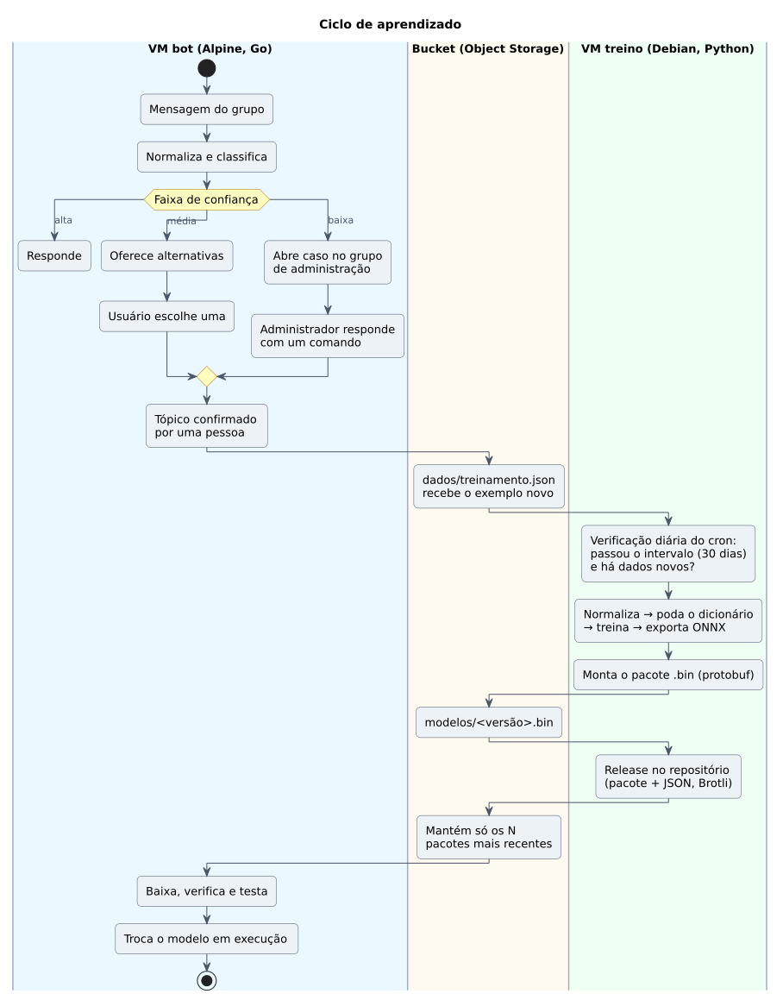

# 01 — Visão geral

Índice: [← Índice](README.md) | [Próximo: Infraestrutura →](02_infraestrutura.md)

Este documento diz o que o sistema faz, quais são suas duas partes, como ele aprende com o uso e define os termos usados no resto da documentação. Cada mecanismo aparece aqui em uma frase e é explicado no documento linkado.

## 1. O que o sistema faz

O Micro Faq AI é um classificador de **tópicos de perguntas** acoplado a um bot de WhatsApp. Uma mensagem chega de um grupo, é normalizada, convertida em vetores e classificada entre os tópicos conhecidos. O bot então:

- **responde** direto, se a confiança é alta;
- **pergunta** se a dúvida é uma de algumas alternativas, se a confiança é média;
- **repassa** a dúvida ao grupo de administração, se a confiança é baixa ou se nenhuma tentativa resolveu.

Cumprimentos, negativas e conversa comum também são tópicos que o modelo aprende — os **tópicos reservados** —, e o bot reage a eles de forma própria: devolve um cumprimento genérico, retoma a dúvida ou fica em silêncio.

As regras completas estão em [Fluxo de resposta](10_fluxo_de_resposta.md).

## 2. Componentes

| Componente | Onde roda | Linguagem | Faz |
|------------|-----------|-----------|-----|
| **Bot** | VM Alpine | Go (binário compilado + ONNX Runtime do Alpine) | Conecta ao WhatsApp, normaliza e classifica mensagens, conversa, grava novos exemplos no JSON de treinamento, carrega novos modelos |
| **Treino** | VM Debian slim | Python + PyTorch (CPU) | Lê o JSON de treinamento, monta o mini-dicionário, treina, exporta ONNX e publica o pacote do modelo |

Os dois não se chamam diretamente: compartilham apenas o bucket do Object Storage ([Infraestrutura §3](02_infraestrutura.md#3-object-storage)). As respostas dos tópicos, os casos abertos com os administradores e a sessão do WhatsApp ficam numa tabela única do NoSQL, acessada só pelo bot ([Dados §1](05_dados.md#1-tabela-única-nosql)).

## 3. Ciclo de aprendizado

Fonte: [`diagramas/01_ciclo_de_aprendizado.puml`](diagramas/01_ciclo_de_aprendizado.puml)

1. Toda escolha confirmada por um usuário e toda resposta de administrador acrescenta exemplos ao JSON de treinamento ([Dados §2](05_dados.md#2-json-de-treinamento)).
2. O cron da VM de treino detecta que o JSON mudou e treina ([Treinamento](06_treinamento.md)).
3. O resultado é um pacote versionado ([Pacote do modelo](07_pacote_modelo.md)) que o bot carrega sem reiniciar ([Carga do modelo](08_carga_do_modelo.md)).

## 4. Princípios

- **Leveza no servidor.** Nada é compilado ou instalado nas VMs; elas recebem artefatos prontos e minimizados ([Build e deploy](03_build_e_deploy.md)).
- **Mesma normalização nos dois lados.** O texto que o modelo vê no treino é byte a byte igual ao que vê no bot ([Normalização §6](04_normalizacao.md#6-paridade-entre-go-e-python)).
- **O pacote é autossuficiente.** Tudo que o bot precisa para classificar — modelo, mini-dicionário, mapa de tópicos e substituições — vem dentro do mesmo `.bin`.
- **VMs sem estado.** Tudo que muda com o uso fica no NoSQL ou no bucket; qualquer VM pode ser recriada do zero ([Infraestrutura §2](02_infraestrutura.md#2-máquinas-virtuais)).
- **Dependências substituíveis.** Runtime ONNX, armazenamento, banco e repositório de releases ficam atrás de interfaces, para trocar de biblioteca, de provedor ou rodar tudo localmente sem mudar o resto do código ([Ambiente local §2](12_ambiente_local.md#2-implementações-locais)).
- **Autenticação configurável.** Dentro da OCI, as VMs se autenticam pela identidade da instância, sem chaves em disco; fora dela, por chave de API ([Infraestrutura §5](02_infraestrutura.md#5-identidade-e-permissões)).
- **Treino em lotes.** Os exemplos novos se acumulam e o modelo é retreinado em intervalos longos, para não sobrecarregar a VM de treino ([Treinamento §1](06_treinamento.md#1-disparo)).

## 5. Glossário

| Termo | Significado |
|-------|-------------|
| **Tópico** | Uma pergunta canônica com uma resposta cadastrada. Identificado por `topic_id`. É a classe que o modelo prevê |
| **Tópico reservado** | `_cumprimento`, `_negacao` ou `_conversa`: treinado como os outros, mas com comportamento próprio no bot — [Dados §1.2](05_dados.md#12-tópicos-reservados) |
| **Exemplo** | Uma frase de usuário rotulada com um tópico; o material de treino |
| **Exemplo canônico** | O único exemplo guardado junto da resposta no NoSQL; é mostrado ao usuário nas alternativas e usado no teste de carga do modelo |
| **Confiança** | A maior probabilidade entre os tópicos não reservados, de 0 a 100 %. Cada tópico tem probabilidade independente (sigmoide), então uma mensagem fora de todos os tópicos tem confiança baixa |
| **Faixa** | Baixa (< 50 %), média (50 % a < 80 %) ou alta (≥ 80 %) — [Fluxo de resposta §1](10_fluxo_de_resposta.md#1-decisão) |
| **Modo de grupo** | Como o bot se comporta num grupo: *marcação*, *autônomo* ou *administração* — [Bot §2](09_bot_grupos.md#2-modos-de-grupo) |
| **Grupo de administração** | O grupo do modo *administração*, para onde vão as dúvidas não resolvidas |
| **Caso** | Uma dúvida aberta no grupo de administração, à espera de um comando de administrador — [Fluxo §6](10_fluxo_de_resposta.md#6-grupo-de-administração) |
| **Substituições** | Dicionário de gírias e abreviações → forma padrão, aplicado com Aho-Corasick — [Normalização §4](04_normalizacao.md#4-substituição-de-gírias-aho-corasick) |
| **Dicionário estático** | Os vetores de palavras pré-treinados (fastText `cc.pt.300`), com milhões de palavras — [Treinamento §2](06_treinamento.md#2-dicionário-estático) |
| **Mini-dicionário** | O recorte do dicionário estático só com as palavras que aparecem no JSON de treinamento, como tensor — [Treinamento §3](06_treinamento.md#3-poda-para-o-mini-dicionário) |
| **Mapa de tópicos** (*intent map*) | Lista que liga cada índice de saída do modelo a um `topic_id`, incluindo os reservados |
| **Pacote do modelo** | O arquivo `.bin` em Protocol Buffers com ONNX, mini-dicionário, mapa de tópicos, substituições e versão — [Pacote do modelo](07_pacote_modelo.md) |

Próximo: [Infraestrutura na OCI →](02_infraestrutura.md)
