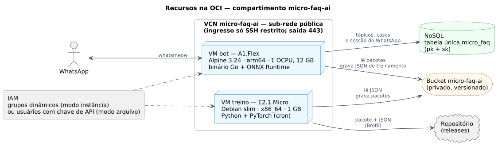

# 02 — Infraestrutura na OCI

Índice: [← Índice](README.md) | [← Visão geral](01_visao_geral.md) | [Próximo: Build e deploy →](03_build_e_deploy.md)

Este documento descreve os recursos da Oracle Cloud que o sistema usa: as duas VMs, o bucket, a tabela NoSQL, a identidade das instâncias e a rede. O formato dos dados guardados em cada recurso está em [Dados](05_dados.md).

## 1. Recursos



<sub>Fonte: [`diagramas/02_recursos_oci.puml`](diagramas/02_recursos_oci.puml)</sub>

Tudo fica em um único compartimento e uma única região, para que as políticas de acesso (§5) sejam escritas sobre o compartimento.

## 2. Máquinas virtuais

| VM | Imagem | Forma | Recursos | Processos |
|----|--------|-------|----------|-----------|
| `bot` | Alpine Linux 3.24 (mínimo 3.23, por causa do pacote `onnxruntime`) | `VM.Standard.A1.Flex` (Ampere, **arm64**) | 1 OCPU, 12 GB | Serviço OpenRC `micro-faq-bot` |
| `treino` | Debian 12 slim | `VM.Standard.E2.1.Micro` (AMD, **x86_64**) | 1/8 de OCPU com *burst*, 1 GB + 4 GB de swap | `cron` disparando o treinamento |

- O bot fica na VM maior porque atende em tempo real e mantém o modelo em memória. O treino fica na menor porque roda poucas vezes e pode levar o dia inteiro ([Treinamento §1.1](06_treinamento.md#11-recursos-da-vm)).
- As arquiteturas são diferentes: o artefato do bot é `linux/arm64` e o do treino é `linux/amd64` ([Build e deploy §1](03_build_e_deploy.md#1-princípio)).
- Nenhuma VM guarda estado próprio: a sessão do WhatsApp fica no NoSQL ([Bot §1.1](09_bot_grupos.md#11-sessão-na-tabela-única)) e o registro do último treino é o último pacote publicado. Qualquer uma das duas pode ser recriada do zero.
- A VM `treino` guarda localmente o dicionário estático já convertido (≈ 2,5 GB, [Treinamento §2](06_treinamento.md#2-dicionário-estático)), lido por *memory map* para não precisar caber em RAM.

## 3. Object Storage

Um bucket privado, `micro-faq-ai`, com **versionamento de objetos ligado**: cada gravação do JSON de treinamento mantém a versão anterior recuperável. O layout dos objetos está em [Dados §3](05_dados.md#3-layout-do-bucket).

| Quem | Lê | Grava |
|------|----|-------|
| `bot` | JSON de treinamento, pacotes de modelo | JSON de treinamento |
| `treino` | JSON de treinamento | Pacotes de modelo |

- **Pacotes de modelo**: ficam os `publicacao.modelos_no_bucket` mais recentes; o próprio treino apaga os mais antigos, com todas as versões do objeto, depois de guardá-los numa release do repositório ([Pacote do modelo §6](07_pacote_modelo.md#6-retenção-e-backup)). O bot sempre usa o mais recente ([Carga do modelo §1](08_carga_do_modelo.md#1-descoberta)).
- **JSON de treinamento**: uma regra de ciclo de vida apaga as versões anteriores de `dados/` com mais de 90 dias. Cada JSON usado num treino fica guardado de forma permanente na release do pacote correspondente.

## 4. NoSQL

Oracle NoSQL Database Cloud Service, tabela única `micro_faq` com capacidade sob demanda. Só a VM `bot` a acessa, pelo SDK oficial Go (`github.com/oracle/nosql-go-sdk`). O esquema está em [Dados §1](05_dados.md#1-tabela-única-nosql).

## 5. Identidade e permissões

Cada componente escolhe a forma de autenticar na OCI pela configuração (`oci.autenticacao`, [Configuração](11_configuracao.md)):

| Modo | Quando usar | Credencial |
|------|-------------|------------|
| `instancia` (padrão) | VMs dentro da OCI | *Instance principal*: a própria VM é a identidade, e nenhuma chave fica em disco |
| `arquivo` | Fora da OCI: outro provedor, máquina local, consultas de manutenção | Chave de API de um usuário IAM, num arquivo de configuração da OCI (`~/.oci/config` e a chave privada, com permissão `600`) |

O mesmo código atende aos dois modos; muda só o provedor de credencial criado na inicialização.

### 5.1. Modo instância

1. Um grupo dinâmico por VM, casando pelo OCID da instância:
   - `micro-faq-bot`: `instance.id = '<ocid da VM bot>'`
   - `micro-faq-treino`: `instance.id = '<ocid da VM treino>'`
2. Políticas no compartimento:

```text
Allow dynamic-group micro-faq-bot    to read buckets   in compartment micro-faq-ai where target.bucket.name = 'micro-faq-ai'
Allow dynamic-group micro-faq-bot    to manage objects in compartment micro-faq-ai where target.bucket.name = 'micro-faq-ai'
Allow dynamic-group micro-faq-bot    to use nosql-rows in compartment micro-faq-ai where target.nosql-table.name = 'micro_faq'
Allow dynamic-group micro-faq-treino to read buckets   in compartment micro-faq-ai where target.bucket.name = 'micro-faq-ai'
Allow dynamic-group micro-faq-treino to manage objects in compartment micro-faq-ai where target.bucket.name = 'micro-faq-ai'
```

### 5.2. Modo arquivo

Um usuário IAM por uso (`micro-faq-externo-bot`, `micro-faq-externo-treino`), cada um num grupo IAM com as mesmas políticas de §5.1, trocando `dynamic-group <nome>` por `group <nome>`. A chave de API é gerada para esse usuário e fica só na máquina que a usa.

### 5.3. Nos SDKs

| Componente | SDK | Modo `instancia` | Modo `arquivo` |
|------------|-----|------------------|----------------|
| Bot → Object Storage | `github.com/oracle/oci-go-sdk/v65` | `auth.InstancePrincipalConfigurationProvider()` | `common.CustomProfileConfigProvider(arquivo, perfil)` |
| Bot → NoSQL | `github.com/oracle/nosql-go-sdk` | `iam.NewSignatureProviderWithInstancePrincipal(compartimento)` | `iam.NewSignatureProviderFromFile(arquivo, perfil, "", compartimento)` |
| Treino → Object Storage | `oci` (Python) | `oci.auth.signers.InstancePrincipalsSecurityTokenSigner()` | `oci.config.from_file(arquivo, perfil)` |

## 6. Rede

- Uma VCN com uma sub-rede pública; as VMs têm IP público só para saída.
- **Ingresso**: apenas SSH (22/tcp) a partir dos IPs dos administradores do servidor, ou pelo serviço OCI Bastion.
- **Saída**: 443/tcp para a internet (servidores do WhatsApp, endpoints da OCI) e 123/udp para NTP.
- Nenhuma porta de aplicação é exposta: o bot é cliente do WhatsApp e da OCI, nunca servidor.

Próximo: [Build e deploy →](03_build_e_deploy.md)
