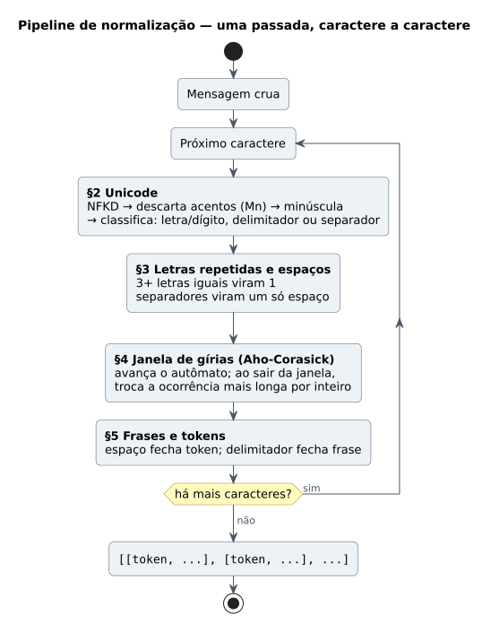

# 04 — Normalização de texto

Índice: [← Índice](README.md) | [← Build e deploy](03_build_e_deploy.md) | [Próximo: Dados →](05_dados.md)

Este documento é o dono do pipeline que transforma uma mensagem crua em frases de tokens. O mesmo pipeline roda no treino (Python, sobre cada exemplo) e no bot (Go, sobre cada mensagem recebida), e os dois precisam produzir exatamente a mesma saída (§6). O que se faz com os tokens depois — vetores e classificação — está em [Treinamento §4](06_treinamento.md#4-representação-vetorial).

## 1. Etapas



<sub>Fonte: [`diagramas/04_pipeline_normalizacao.puml`](diagramas/04_pipeline_normalizacao.puml)</sub>

A normalização é **uma única passada** pela mensagem. Cada caractere é lido uma vez e atravessa todas as etapas antes do próximo ser lido: Unicode (§2), letras repetidas e espaços (§3), gírias (§4) e frases e tokens (§5). Nenhuma etapa produz um texto intermediário para a seguinte reler.

- **Sem expressões regulares.** Cada etapa é uma decisão sobre o caractere atual e um estado pequeno — o caractere anterior, um contador, a janela de §4. O custo é linear no tamanho da mensagem, e a memória usada é fixa, do tamanho da maior gíria do dicionário.
- **Implementação própria nos dois lados.** O resultado depende de detalhes (fronteira de palavra, escolha da ocorrência mais longa), então Go e Python implementam o mesmo algoritmo a partir desta especificação, sem bibliotecas de Aho-Corasick ou de expressões regulares. Em Python o laço é mais lento, o que não pesa: o treino roda fora do horário de uso.
- As chaves do dicionário de substituições passam pelas etapas §2 e §3 ao serem carregadas, para estarem na mesma forma do texto que vão casar.

## 2. Unicode

Para cada caractere lido:

1. **Decomposição NFKD**: o caractere vira um ou mais caracteres, pela tabela Unicode. Unifica formas de compatibilidade (letras de largura total, ligaduras, numerais sobrescritos) e separa os acentos das letras (`ç` → `c` + cedilha).
2. **Remoção de acentos**: caracteres da categoria `Mn` (marcas não espaçadoras) são descartados. `você` → `voce`, `ação` → `acao`.
3. **Minúsculas**, pelo mapeamento simples de um caractere para um caractere (`unicode.ToLower` em Go). Como a decomposição vem antes, os casos em que a minúscula de um caractere teria dois (`İ`) já chegam aqui sem a marca e se resolvem igual nos dois lados.
4. **Classificação** do caractere resultante:

| Classe | Caracteres | Vai para |
|--------|-----------|----------|
| Letra ou dígito | Categorias `L*` e `N*` | §3 |
| Delimitador de frase | `. ! ? ;` e quebra de linha | §5, como fim de frase |
| Separador | Todo o resto: espaços, emojis, símbolos, aspas | §3, como espaço |

## 3. Letras repetidas e espaços

**Letras repetidas.** Uma sequência de **três ou mais** letras iguais vira **uma**: `simmmm` → `sim`, `kkkkkk` → `k`, `nãoooo` → `nao`. Sequências de duas ficam como estão, porque são legítimas em português (`carro`, `assim`, `voo`). Dígitos não são alterados. Na passada, isso é um contador: a letra fica retida enquanto se repete, e sai — uma vez ou como veio — quando chega um caractere diferente.

**Espaços.** Um separador só gera espaço se o último caractere emitido foi letra ou dígito. Assim, qualquer sequência de espaços, emojis e símbolos vira **um** espaço, e não há espaço no início de uma frase. O espaço no fim de uma frase é descartado em §5.

## 4. Substituição de gírias (Aho-Corasick)

O dicionário de substituições mapeia gírias, abreviações e erros comuns para a forma padrão (`vc` → `voce`, `pq` → `por que`, `msm` → `mesmo`), de modo que variações de escrita não mudem a classificação. A fonte do dicionário é o JSON de treinamento ([Dados §2](05_dados.md#2-json-de-treinamento)); o bot usa a cópia que vem dentro do pacote do modelo, a mesma com que o modelo foi treinado ([Pacote do modelo §2](07_pacote_modelo.md#2-campos)).

O autômato de Aho-Corasick acompanha **todas** as chaves ao mesmo tempo enquanto os caracteres passam, sem voltar atrás no texto. Ele é construído uma vez, quando o pacote do modelo é carregado.

**Janela.** Os caracteres que saem de §3 passam por uma janela de tamanho igual à maior chave do dicionário, mais as duas fronteiras:

1. Cada caractere entra na janela e avança o autômato.
2. Uma ocorrência só vale se começa e termina em **fronteira de palavra**: início da frase, espaço ou delimitador. Assim `vc` casa em `vc vem`, mas não em `avcd`.
3. Um caractere só sai da janela quando nenhuma chave que comece nele ou antes dele ainda pode se completar. Nesse momento, se uma ocorrência válida começa ali, ela é trocada **inteira** pelo valor; havendo várias, vale a **mais longa** (`por que` ganha de `por`).
4. O valor substituído segue direto para §5, sem voltar ao autômato: uma substituição nunca dispara outra. O valor pode ter várias palavras ou ser vazio.
5. No fim de cada frase, a janela é esvaziada pelas mesmas regras.

O resultado não depende da ordem das chaves, e a mensagem é lida uma vez só, por maior que seja o dicionário.

## 5. Frases e tokens

Na saída da janela:

1. Letras e dígitos se acumulam no **token** atual; um espaço fecha o token.
2. Um delimitador fecha o token e a **frase** atual. Frases sem tokens são descartadas, e os delimitadores não viram tokens.
3. Quando uma pergunta é composta por várias mensagens (rajada do modo autônomo, [Bot §2.2](09_bot_grupos.md#22-autônomo)), cada mensagem passa pela normalização separadamente e as frases são concatenadas na ordem de chegada; uma frase nunca atravessa duas mensagens.
4. Uma mensagem sem frases não é classificável.

Exemplo:

```text
entrada: "Oi!!  Vc sabe qnd abre a matrícula?? 🙏\nPrecisa de RG, simmmm"
saída:   [["oi"], ["voce", "sabe", "quando", "abre", "a", "matricula"], ["precisa", "de", "rg", "sim"]]
```

## 6. Paridade entre Go e Python

Uma diferença de um caractere entre treino e bot faz uma palavra cair fora do mini-dicionário e muda a classificação sem erro visível. Por isso:

- O arquivo `testdata/normalizacao.jsonl` contém casos `{"entrada": ..., "substituicoes": {...}, "saida": [[...]]}`, cobrindo acentos, emojis, espaços, letras repetidas, fronteiras de gírias, chaves que são prefixo de outras e rajadas. Os testes de Go e de Python leem o mesmo arquivo e ambos precisam passar.
- O pipeline tem um número de versão, `versao_normalizacao`, gravado no pacote do modelo. Qualquer mudança que altere a saída de algum caso incrementa esse número, e o bot só carrega pacotes cuja versão de normalização ele implementa ([Carga do modelo §2](08_carga_do_modelo.md#2-verificação)).

Próximo: [Dados →](05_dados.md)
