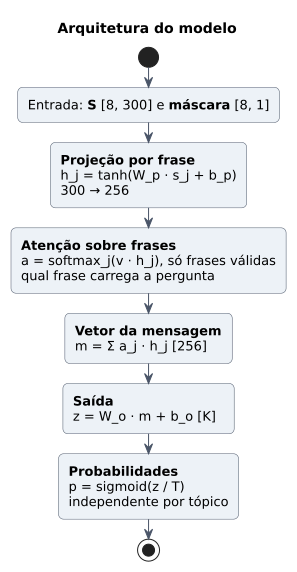

# 06 — Treinamento

Índice: [← Índice](README.md) | [← Dados](05_dados.md) | [Próximo: Pacote do modelo →](07_pacote_modelo.md)

Este documento descreve o que roda na VM `treino`: o disparo pelo cron, o dicionário estático, a poda para o mini-dicionário, a representação vetorial das frases, o modelo PyTorch e a exportação ONNX. O empacotamento do resultado é de [Pacote do modelo](07_pacote_modelo.md); a normalização usada aqui é a de [Normalização](04_normalizacao.md).

## 1. Disparo

O treino roda **em lotes**: os exemplos novos se acumulam no JSON durante o intervalo configurado (`agenda.intervalo_dias`, 30 dias por padrão, [Configuração §2](11_configuracao.md#2-treino)) e só então viram um modelo novo. Assim a VM `treino` trabalha poucas vezes, e cada modelo novo aprende com um volume que justifica o trabalho.

O cron chama `/opt/micro-faq-ai/bin/treinar` uma vez por dia, de madrugada, com `nice` e sob `flock`, para que duas execuções nunca se sobreponham. A execução diária é só uma verificação barata; ela treina quando as duas condições valem:

1. o pacote mais recente em `modelos/` foi gerado há mais de `agenda.intervalo_dias` (`versao.gerado_em_ms`, [Pacote do modelo §3](07_pacote_modelo.md#3-versionamento)), ou não existe nenhum pacote; e
2. o SHA-256 de `dados/treinamento.json` é diferente do `sha256_treinamento` desse pacote — há dados novos.

Não existe estado local: o último pacote publicado é o registro do último treino. Uma execução que falha não publica nada, e a verificação do dia seguinte tenta de novo; uma execução bem-sucedida publica um pacote novo, e as verificações seguintes esperam outro intervalo.

Quando treina, a execução baixa o JSON, normaliza todos os exemplos (§3), monta o mini-dicionário (§3), treina (§5), exporta (§6) e publica (§7).

### 1.1. Recursos da VM

A VM `treino` é a menor disponível, com 1 GB de RAM ([Infraestrutura §2](02_infraestrutura.md#2-máquinas-virtuais)), e o treino pode levar horas sem prejuízo. O que o faz caber:

- o dicionário estático é lido por *memory map* (§2.1), sem ocupar RAM de forma fixa;
- PyTorch roda com `torch.set_num_threads(1)`, e os exemplos são processados em lotes pequenos (`modelo.tamanho_lote`);
- a VM tem um arquivo de swap de 4 GB, como margem para picos de memória da importação do PyTorch e da exportação ONNX.

Tópicos sem nenhum exemplo são ignorados no treino e, portanto, ficam fora do mapa de tópicos. Os tópicos reservados ([Dados §1.2](05_dados.md#12-tópicos-reservados)) são a exceção: se algum deles está sem exemplos, a execução falha.

## 2. Dicionário estático

O dicionário estático são os vetores pré-treinados do **fastText `cc.pt.300`**: 2 milhões de palavras do português em 300 dimensões, treinados sobre Common Crawl e Wikipédia. Ele serve aqui porque:

- o Common Crawl contém texto informal da web, próximo da escrita de grupos de WhatsApp;
- além do vetor de cada palavra, o fastText guarda vetores de **n-gramas de caracteres** (5 caracteres), então uma palavra que não está no vocabulário — erro de digitação, flexão rara — ainda recebe um vetor coerente, montado pelos seus pedaços.

A licença dos vetores é CC BY-SA 3.0; a atribuição fica no README do projeto.

### 2.1. Formato convertido

O `cc.pt.300.bin` original é convertido uma vez, fora do servidor ([Build e deploy §5](03_build_e_deploy.md#5-dicionário-estático)), para:

| Arquivo | Conteúdo |
|---------|----------|
| `palavras.txt` | Uma palavra por linha; a linha *i* corresponde à linha *i* de `vetores.f16.npy` |
| `vetores.f16.npy` | Matriz `[N, 300]` `float16` com o vetor final de cada palavra |
| `ngramas.f16.npy` | Matriz `[2 000 000, 300]` `float16` com os vetores dos *buckets* de n-gramas |
| `meta.json` | `dimensao`, `minn`, `maxn`, `buckets` e a `versao_normalizacao` usada na conversão |

As matrizes são abertas com `numpy.load(..., mmap_mode="r")`: só as linhas consultadas são lidas do disco, e a VM não precisa de RAM para os 2,5 GB — o que permite treinar numa VM de 1 GB (§1.1).

### 2.2. Vocabulário normalizado

O texto que chega ao modelo já passou pelas etapas Unicode e de espaços ([Normalização §2–3](04_normalizacao.md#2-unicode)) — sem acentos, em minúsculas. O vocabulário do fastText é convertido para a mesma forma: cada palavra é normalizada, e quando várias colapsam na mesma chave (`você`, `voce`, `Você`) fica o vetor da mais frequente, que é a primeira na ordem do fastText. Chaves vazias ou com espaço são descartadas.

### 2.3. Vetor de palavra fora do vocabulário

Para uma palavra *w* que não está em `palavras.txt`, o vetor é a média das linhas de `ngramas.f16.npy` dos seus n-gramas, como no fastText:

1. *w* é envolvida em `<` e `>`; extraem-se todas as subsequências de 5 caracteres (caracteres UTF-8, não bytes).
2. Cada n-grama recebe o hash FNV-1a de 32 bits sobre os seus bytes — com cada byte convertido para `int8` com sinal antes do XOR, como no código C++ do fastText — e o índice é `hash mod 2 000 000`.
3. O vetor é a média das linhas encontradas. Uma palavra curta demais para ter n-gramas não recebe vetor e é tratada como desconhecida.

## 3. Poda para o mini-dicionário

O modelo só precisa dos vetores das palavras que aparecem nos exemplos. O mini-dicionário é esse recorte:

1. Todos os exemplos do JSON são normalizados com as substituições do próprio JSON ([Normalização](04_normalizacao.md)).
2. O conjunto de tokens distintos é ordenado alfabeticamente. Os índices 0 e 1 são reservados para `<pad>` e `<unk>`; os tokens começam no índice 2.
3. Para cada token, o vetor vem de `vetores.f16.npy` ou, na ausência, de §2.3. Tokens sem vetor saem do mini-dicionário.
4. O resultado é o tensor `E` de forma `[V, 300]` em `float32`, com as linhas de `<pad>` e `<unk>` zeradas.

Com alguns milhares de palavras, `E` tem poucos megabytes e viaja dentro do pacote do modelo. No bot, um token fora do mini-dicionário vira `<unk>` e é ignorado; uma palavra nova passa a contar a partir do treinamento seguinte em que ela aparece nos exemplos.

## 4. Representação vetorial

A mensagem vira uma matriz de vetores de frases por álgebra vetorial simples, da mesma forma no treino (PyTorch) e no bot (Go, [Carga do modelo §5](08_carga_do_modelo.md#5-inferência)):

1. Cada token *t* da frase *j* vira o seu vetor `E[t]`.
2. O vetor da frase é a média dos vetores dos seus tokens conhecidos: `s_j = (1/n_j) · Σ E[t]`, somando só tokens diferentes de `<unk>`. Uma frase sem tokens conhecidos é descartada.
3. Cada `s_j` é normalizado para norma L2 igual a 1, para que o tamanho da frase não pese na direção.
4. A mensagem é a matriz `S` de forma fixa `[8, 300]`: as primeiras 8 frases, uma por linha, e linhas zeradas completando o que faltar. Uma máscara `[8, 1]` marca com 1 as linhas válidas. O tamanho fixo é exigido pelo runtime ONNX do bot (§6); as linhas de preenchimento recebem peso zero na atenção, então o resultado é igual ao de uma matriz só com as frases válidas.

Tudo que depende de `E` acontece antes do modelo; o modelo recebe `S` e a máscara.

## 5. Modelo

### 5.1. Arquitetura

Fonte: [`diagramas/06_arquitetura_modelo.puml`](diagramas/06_arquitetura_modelo.puml)

- A atenção sobre frases permite que uma mensagem como "bom dia. quando abre a matrícula?" seja classificada pela segunda frase.
- A saída é **sigmoide por tópico**, não uma distribuição que soma 1: cada tópico responde sozinho "esta mensagem é minha?". Uma mensagem que não se parece com nenhum tópico recebe valores baixos em todos, em vez de ser empurrada para o menos distante. O que ensina o modelo a dar valores baixos são os exemplos de `_conversa` e os alvos zero de cada exemplo nos demais tópicos (§5.2).
- O mini-dicionário `E` fica **congelado**: o modelo aprende só `W_p`, `b_p`, `v`, `W_o`, `b_o`. Com poucos exemplos por tópico, ajustar os vetores das palavras decoraria os exemplos; e o `E` do pacote é exatamente o que foi usado no treino.
- `T` é a temperatura de calibração (§5.3); com ela, a confiança se aproxima da taxa real de acerto, e as faixas de 50 % e 80 % ([Fluxo §1](10_fluxo_de_resposta.md#1-decisão)) têm significado.

### 5.2. Treino

| Parâmetro | Valor |
|-----------|-------|
| Divisão | Estratificada 85 % treino / 15 % validação, só para tópicos com 3 ou mais exemplos; os demais entram inteiros no treino |
| Perda | Entropia cruzada binária por tópico (`BCEWithLogitsLoss`): alvo 1 no tópico do exemplo e 0 em todos os outros, com `pos_weight` de cada tópico igual à razão entre exemplos negativos e positivos dele |
| Otimizador | AdamW, taxa 1e-3, *weight decay* 1e-4 |
| Regularização | Dropout 0,3 em `m`; descarte aleatório de 10 % dos tokens e de frases inteiras (mantendo ao menos uma) a cada época |
| Épocas | Até 200, com parada antecipada quando a perda de validação não melhora por 15 épocas |
| Lote | 32 exemplos por passo (`modelo.tamanho_lote`) |
| Semente | Fixa, para que o mesmo JSON gere o mesmo modelo |

Os valores ficam no arquivo de configuração do treino ([Configuração §2](11_configuracao.md#2-treino)).

### 5.3. Calibração e portão de qualidade

1. Com os pesos finais, `T` é ajustado na validação minimizando a entropia cruzada binária (*temperature scaling*); sem validação, `T = 1`.
2. Calculam-se acurácia e F1 macro na validação. Se o F1 macro ficar abaixo de `f1_minimo` da configuração, o pacote não é publicado e a execução termina com erro (o estado local não avança, §1).

## 6. Exportação ONNX

O modelo é exportado com `torch.onnx.export` (exportador TorchScript, `dynamo=False`), **opset 13**, com `T` embutido como constante. O opset e as formas fixas são os que o runtime ONNX do bot aceita ([Carga do modelo §5](08_carga_do_modelo.md#5-inferência)):

| Tensor | Tipo | Forma |
|--------|------|-------|
| Entrada `sentencas` | `float32` | `[1, 8, 300]` |
| Entrada `mascara` | `float32` | `[1, 8, 1]` (1 = frase válida) |
| Saída `probabilidades` | `float32` | `[1, 1, K]` |

- O grafo segue o contrato que os dois runtimes ONNX do bot executam — opset 13, formas fixas, sem `ReduceSum`, `Squeeze` e `Unsqueeze` ([Carga do modelo §5.1](08_carga_do_modelo.md#51-runtime-onnx)). No código PyTorch, isso significa escrever a atenção como `softmax(scores, dim=1).transpose(1, 2)` seguido de `matmul` com `h`, sem `squeeze`/`sum`. A máscara é aplicada somando `(mascara − 1) · 1e9` antes do softmax da atenção.
- `onnx.checker.check_model` valida o grafo, e o `onnxruntime` do Python roda a validação inteira: a diferença máxima entre as saídas do PyTorch e do ONNX precisa ser menor que 1e-5.

## 7. Publicação

Em ordem, e cada passo só começa se o anterior deu certo:

1. O ONNX, o mini-dicionário, o mapa de tópicos, as substituições normalizadas, a versão e as métricas são gravados num pacote ([Pacote do modelo](07_pacote_modelo.md)) e enviados para `modelos/` no bucket. A partir daí, quem decide usar o pacote é o bot ([Carga do modelo](08_carga_do_modelo.md)).
2. O pacote e a cópia do JSON de treinamento usada são comprimidos e publicados como release no repositório ([Pacote do modelo §6](07_pacote_modelo.md#6-retenção-e-backup)).
3. Só com a release publicada, os pacotes mais antigos do bucket além dos `publicacao.modelos_no_bucket` mais recentes são apagados. Uma falha na release deixa o bucket com um pacote a mais, nunca com um backup a menos.

Próximo: [Pacote do modelo →](07_pacote_modelo.md)
