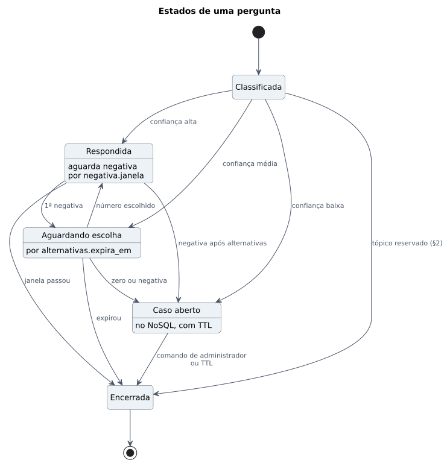

# 10 — Fluxo de resposta

Índice: [← Índice](README.md) | [← Bot e modos de grupo](09_bot_grupos.md) | [Próximo: Configuração →](11_configuracao.md)

Este documento é o dono das regras de decisão depois que uma pergunta foi capturada ([Bot §2](09_bot_grupos.md#2-modos-de-grupo)) e classificada ([Carga do modelo §5](08_carga_do_modelo.md#5-inferência)): o comportamento dos tópicos reservados, o que fazer em cada faixa de confiança, como tratar uma resposta negativa, como funciona o grupo de administração e quando um exemplo novo é gravado.

## 1. Decisão

A classificação devolve todos os tópicos com a sua probabilidade, em ordem decrescente. Cada probabilidade é independente das outras (saída sigmoide, [Treinamento §5.1](06_treinamento.md#51-arquitetura)): uma mensagem que não se parece com nenhum tópico recebe valores baixos em todos.

1. Se o primeiro da lista é um **tópico reservado** ([Dados §1.2](05_dados.md#12-tópicos-reservados)) com probabilidade ≥ `faixas.media`, o bot aplica o comportamento dele (§2) e a decisão termina.
2. Senão, os tópicos reservados saem da lista, e a **confiança** é a probabilidade do primeiro tópico restante. A faixa decide a ação:

| Faixa | Confiança | Ação |
|-------|-----------|------|
| Alta | ≥ 80 % | Responde direto (§3) |
| Média | ≥ 50 % e < 80 % | Oferece alternativas (§4) |
| Baixa | < 50 % | Abre caso no grupo de administração (§6) |

Os limites são `faixas.media` e `faixas.alta` da configuração ([Configuração §1](11_configuracao.md#1-bot)). **Toda dúvida que o bot não resolve termina no grupo de administração**: é o único fallback. As exceções são as que o próprio usuário abandona — alternativas que expiram sem escolha (§4).

## 2. Tópicos reservados

| Tópico | Comportamento |
|--------|---------------|
| `_cumprimento` | Envia a `resposta` do tópico (o cumprimento genérico), citando a mensagem. No máximo um cumprimento por grupo a cada `cumprimento.intervalo`, para que uma sequência de "bom dia" num grupo movimentado receba uma só resposta |
| `_negacao` | Só tem efeito como resposta negativa (§5). Fora desse contexto, é tratado como `_conversa` |
| `_conversa` | Nada é enviado; a pergunta é encerrada |

Uma mensagem sem nenhum token conhecido pelo mini-dicionário ([Carga do modelo §5](08_carga_do_modelo.md#5-inferência)) também é tratada como `_conversa`.

## 3. Confiança alta

1. O bot busca a `resposta` do tópico ([Dados §1.1](05_dados.md#11-tópico)) e a envia citando a pergunta.
2. A pergunta fica em estado **respondida** por `negativa.janela`, à espera de uma resposta negativa (§5).
3. Passada a janela sem negativa, a pergunta é encerrada. Nenhum exemplo é gravado: a ausência de reclamação não confirma o tópico.

## 4. Confiança média: alternativas

1. O bot reúne até `alternativas.maximo` tópicos não reservados, em ordem de probabilidade, com probabilidade ≥ `alternativas.probabilidade_minima`.
2. Envia, citando a pergunta, o **exemplo canônico** de cada um, numerado, mais a opção zero:

   ```text
   Sua dúvida é uma destas?
   1. Quando abre a matrícula do semestre?
   2. Como faço a rematrícula?
   0. Nenhuma delas
   ```

3. A pergunta fica em estado **aguardando escolha** por `alternativas.expira_em`. Vale como escolha uma mensagem **do autor da pergunta**, no mesmo grupo, que cite a mensagem das alternativas ou cujo texto normalizado seja só um número. Isso vale em qualquer modo de grupo: no modo marcação a escolha não precisa mencionar o bot, e no modo autônomo ela não é classificada como pergunta nova.
4. Resultado:
   - **Número de uma alternativa**: envia a resposta desse tópico citando a pergunta e grava a pergunta como exemplo do tópico (§7). A pergunta passa a **respondida** (§3.2), como numa confiança alta.
   - **Zero** ou uma negativa (§5): abre caso (§6).
   - **Expiração**: a pergunta é encerrada sem mais nenhuma mensagem.

## 5. Resposta negativa

Uma **negativa** é uma mensagem do autor da pergunta que cita uma mensagem do bot sobre essa pergunta — a resposta ou as alternativas —, enviada enquanto a pergunta está *respondida* ou *aguardando escolha*, e que a classificação põe em `_negacao` com probabilidade ≥ `faixas.media`. Como `_negacao` é um tópico treinado, as formas de dizer "não era isso" crescem com os exemplos, como qualquer outro tópico.

Uma mensagem que cita o bot mas não é negativa segue a captura normal do modo do grupo ([Bot §2](09_bot_grupos.md#2-modos-de-grupo)).

| A negativa veio depois de | O bot |
|---------------------------|-------|
| Resposta de confiança alta | Trata de novo: oferece alternativas (§4) com os tópicos seguintes do mesmo resultado, excluindo o já respondido. Sem nenhum tópico acima de `alternativas.probabilidade_minima`, abre caso |
| Alternativas | Abre caso |
| Resposta escolhida nas alternativas | Abre caso |

Cada pergunta passa por no máximo uma rodada de alternativas.

### 5.1. Estados de uma pergunta



<sub>Fonte: [`diagramas/10_estados_pergunta.puml`](diagramas/10_estados_pergunta.puml)</sub>

Os estados *respondida* e *aguardando escolha* vivem em memória: um reinício do bot os perde, e essas perguntas simplesmente não recebem acompanhamento. Os casos abertos são persistidos no NoSQL (§6.1).

## 6. Grupo de administração

### 6.1. Caso

Abrir um caso é enviar ao grupo de administração uma mensagem como:

```text
❓ Grupo "Turma ADS 2026" — Maria
"qnd sai o resultado da prova substitutiva?"
Palpites: k3f9q2x1 47% · p8x1za0m 21% · m2c7tt4k 9%
Responda citando esta mensagem.

k3f9q2x1 — Quando sai o resultado das provas?
p8x1za0m — Onde vejo minhas notas?
m2c7tt4k — Qual o prazo da prova substitutiva?
```

A lista no fim traz o exemplo canônico de cada tópico dos palpites ([Dados §1.1](05_dados.md#11-tópico)), para que o administrador saiba o que cada identificador representa sem consultar `/topicos`.

O caso é gravado na tabela única, com a chave igual ao identificador dessa mensagem e TTL de `casos.expira_em` ([Dados §1.3](05_dados.md#13-caso)), porque um administrador pode responder horas depois, inclusive depois de um reinício do bot. Um caso que expira some sem aviso.

### 6.2. Comandos

Comandos que se referem a um caso são enviados **citando a mensagem do caso**:

| Comando | Efeito |
|---------|--------|
| `/topico <topic_id>` | A dúvida é de um tópico existente: envia a resposta dele ao autor e grava a pergunta como exemplo do tópico |
| `/novo <resposta>` | A dúvida é de um tópico novo: gera um `topic_id`, grava na tabela a resposta e a própria pergunta como exemplo canônico, grava a pergunta como primeiro exemplo no JSON e envia a resposta ao autor |
| `/ignorar` | Não é uma dúvida: encerra o caso sem responder e grava a mensagem como exemplo de `_conversa`, para que mensagens parecidas deixem de chegar aos administradores |

Comandos de manutenção, sem citação:

| Comando | Efeito |
|---------|--------|
| `/exemplo <topic_id> <frase>` | Grava mais um exemplo do tópico, para o próximo treino; vale também para os tópicos reservados (`/exemplo _negacao nada a ver`) |
| `/resposta <topic_id> <texto>` | Troca a resposta do tópico na tabela; para `_cumprimento`, troca o cumprimento genérico |
| `/canonico <topic_id> <frase>` | Troca o exemplo canônico do tópico |
| `/girias <de> = <para>` | Acrescenta ou troca uma substituição no JSON ([Normalização §4](04_normalizacao.md#4-substituição-de-gírias-aho-corasick)); passa a valer no bot com o pacote do próximo treino |
| `/topicos` | Lista os tópicos com `topic_id` e exemplo canônico |

Cada comando é confirmado com uma reação ✅ na mensagem do administrador, ou com uma resposta de erro. Um caso resolvido é apagado da tabela.

### 6.3. Entrega ao autor

A resposta de um caso é enviada no grupo de origem citando a mensagem da pergunta. Se a mensagem citada não existe mais, o bot envia sem citação, mencionando o autor. A pergunta resolvida por caso é encerrada direto, sem janela de negativa.

## 7. Gravação de exemplos

Uma mensagem só vira exemplo quando o tópico foi **confirmado** por uma pessoa:

| Origem | Tópico gravado |
|--------|----------------|
| Autor escolheu uma alternativa (§4) | O escolhido |
| `/topico` | O indicado |
| `/novo` | O criado |
| `/ignorar` | `_conversa` |
| `/exemplo` | O indicado |

A gravação usa a fila e o protocolo condicional de [Dados §2.2](05_dados.md#22-gravação-concorrente). O exemplo entra no modelo no próximo treinamento ([Treinamento §1](06_treinamento.md#1-disparo)).

Próximo: [Configuração →](11_configuracao.md)
